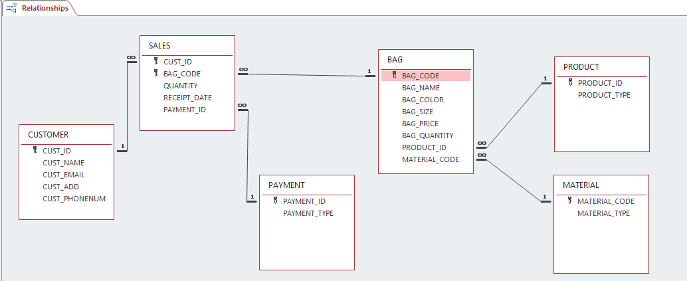
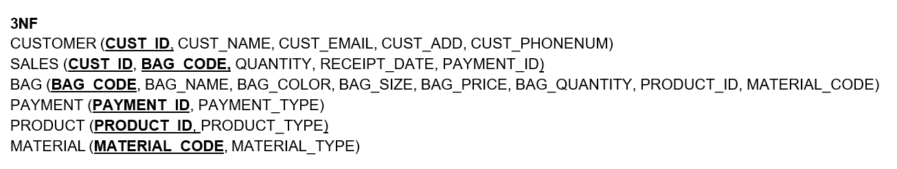
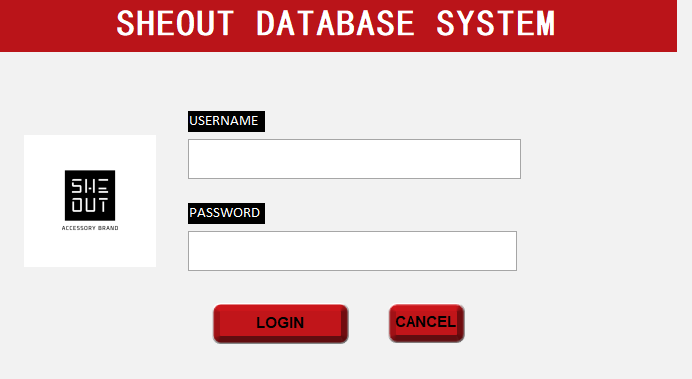
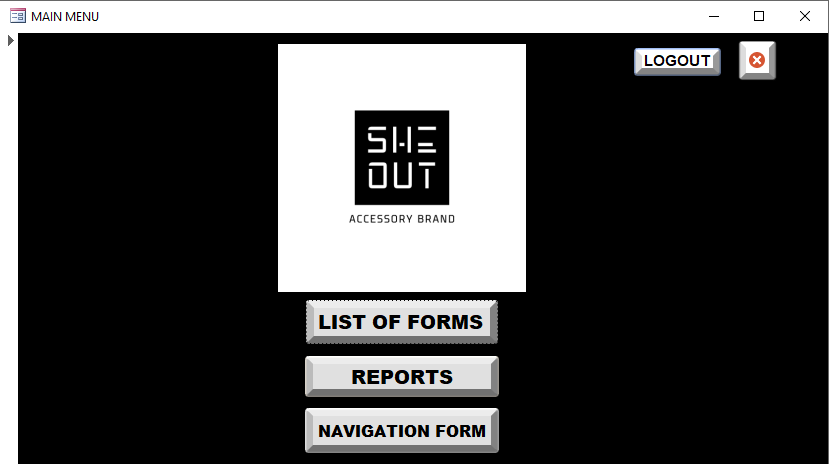
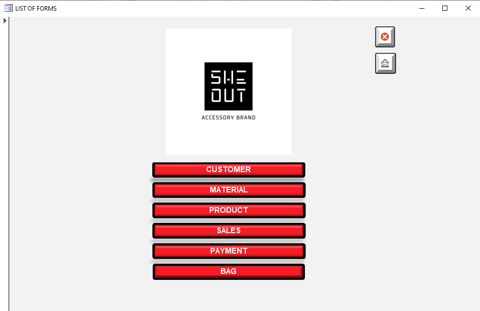
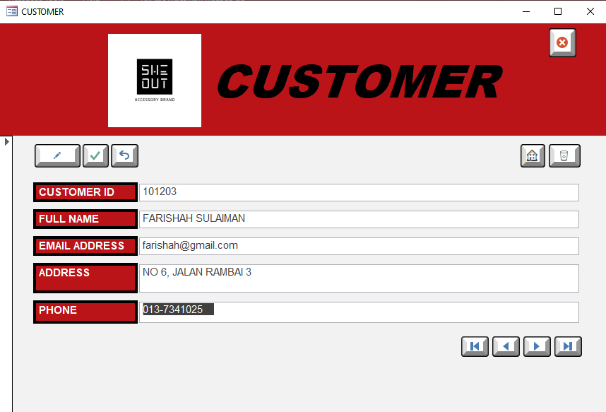
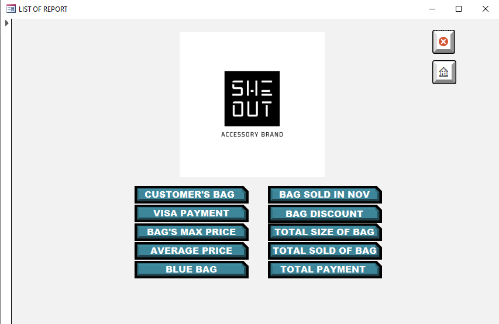
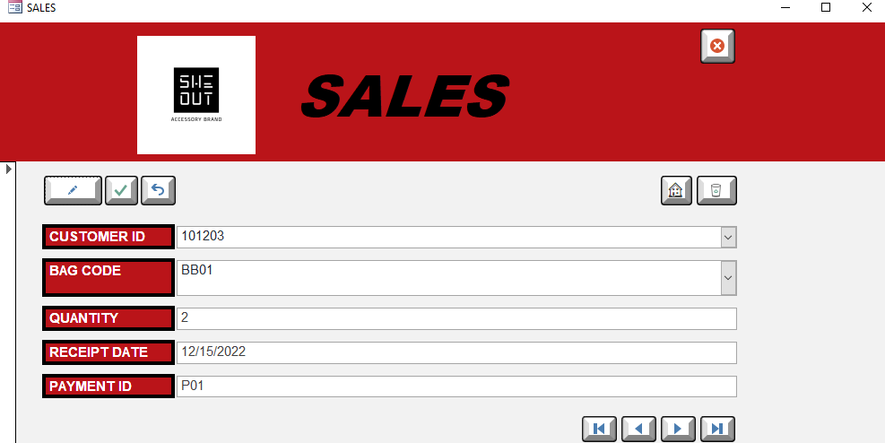

# 👜 SheOut Sales Management System
### Turning Retail Records into an Organised Database System

**How can a retail business manage its customers, products, inventory and sales transactions more systematically?**

The **SheOut Sales Management System** is an academic group project that explores how relational database design and SQL can improve the way a retail business organises and manages its information.

Developed using **Microsoft Access**, the system brings together customer records, product details, bag inventory, sales transactions and payment information in a structured database. It also features data-entry forms, SQL queries and report generation to support business information management and analysis.

---

## 📌 Project Overview

| Category | Details |
|---|---|
| Project | SheOut Sales Management System |
| Industry | Retail / Fashion |
| Database Platform | Microsoft Access |
| Query Language | SQL |
| Database Design | Entity Relationship Diagram (ERD) |
| Normalisation | Third Normal Form (3NF) |
| Database Structure | 6 related tables |
| SQL Queries | 10 queries |
| Report Outputs | 21 reports |
| Project Type | Academic Group Project |
| Year | 2023 |

## 🛍️ 01. Business Context: The Challenge of Managing Retail Records

SheOut is a bag retail business offering different types of bags, including shoulder bags, crossbody bags, bucket bags, saddle bags and totes.

Managing customer details, product information, stock records and sales transactions manually can make it difficult to retrieve information and monitor business activities.

This project addresses the challenge by proposing a centralised database system that organises related business information and makes records easier to maintain and retrieve.

### Project Objectives

- Organise customer and product information in a structured database.
- Generate sales bag reports for business reference.
- Analyse company performance and support business decision-making.

## 🗄️ 02. Database Design: Connecting Business Information

A well-structured database starts with understanding how different pieces of business information relate to one another.

The system uses an **Entity Relationship Diagram (ERD)** to represent the relationships between six main entities.

### Entity Relationship Diagram (ERD)

### Six Core Database Tables

| Database Table | Information Managed |
|---|---|
| **CUSTOMER** | Customer names, email addresses, contact numbers and addresses |
| **SALES** | Sales transactions, customers, bags, quantities and receipt dates |
| **BAG** | Bag names, colours, sizes, prices, stock quantities, products and materials |
| **PAYMENT** | Payment identifiers and payment methods |
| **PRODUCT** | Product categories |
| **MATERIAL** | Bag material categories |

Primary and foreign keys establish relationships between the tables, allowing related business records to be connected.

## 🔄 03. Database Normalisation: Building a Reliable Structure

Storing all business information in a single table can lead to unnecessary duplication and difficulties when updating records.

To address this, the database design applies **Third Normal Form (3NF)** through a structured normalisation process.

### From Unstructured Data to a Relational Schema

The database design progresses through the normalisation stages to organise attributes and dependencies into related tables.

The final relational schema separates customer, sales, bag, payment, product and material information into six related tables. This structure helps reduce data redundancy and supports more systematic record management.

## 💻 04. SQL Development: Turning Business Questions into Queries

Beyond storing information, SQL makes it possible to retrieve specific records, perform calculations and examine business activities.

The project includes **10 SQL queries**, supported by Data Definition Language (DDL) and Data Manipulation Language (DML).

### Data Definition Language (DDL)

DDL statements were used to create and modify database structures.

| SQL Statement | Purpose |
|---|---|
| `CREATE TABLE` | Create database tables |
| `ALTER TABLE` | Modify existing table structures |
| `DROP COLUMN` | Remove a column from a table |

### Data Manipulation Language (DML)

The DML queries explore different business scenarios, including:

| No. | Business Question |
|---|---|
| 01 | Which customers purchased canvas bags? |
| 02 | Which customers paid using VISA for bags priced at RM50 and above? |
| 03 | What is the average bag price for each product type? |
| 04 | Which customers purchased blue bags? |
| 05 | What sales were recorded in November 2022, and what were the stock balances? |
| 06 | What are the discounted prices after applying a 5% discount to bags priced between RM50 and RM120? |
| 07 | What is the total value of bags sold? |
| 08 | What are the customer payment records? |
| 09 | How many bags are available across sizes XS to XL? |
| 10 | Which bag has the highest selling price? |

These queries demonstrate practical SQL applications involving data filtering, calculations, aggregation, grouping and multi-table data retrieval.

## 🖥️ 05. System Features: From Data Entry to Reports

A database is more useful when users can interact with its information through a clear interface.

The SheOut system was implemented in Microsoft Access 2019, with forms for managing records and reports for presenting business information.

### Login Interface

The login page provides an entry point to the database system.

### Main Menu

The main menu provides navigation to the system's available forms and reports.

### Available Forms

The system provides a dedicated list of available forms for accessing and managing different types of business records.

The six forms cover customer, bag, sales, payment, product and material information, allowing users to navigate to the relevant data-entry interface.

### Data Entry Forms

The system includes six data-entry forms:

- Customer Form
- Bag Form
- Sales Form
- Payment Form
- Product Form
- Material Form

Users can add, save, edit, delete and navigate records through the available forms.

### Available Reports

The system also provides a dedicated list of available reports, making it easier to identify and access the different report outputs.

These reports cover various aspects of the business, including customer, product, inventory and sales information.

### Report Generation

The reporting interface provides access to **21 report outputs** presenting different types of business information.

These reports support the retrieval and presentation of customer, product, inventory and sales records.

## 🌟 06. Project Highlights

The project brought together relational database design, SQL querying and Microsoft Access interface development in one retail management system.

| Project Component | Deliverable |
|---|---|
| Database Design | 6 related tables |
| Database Relationships | Primary and foreign key relationships |
| Normalisation | Third Normal Form (3NF) |
| SQL Development | 10 SQL queries |
| Data Management | 6 data-entry forms |
| Reporting | 21 report outputs |
| System Interface | Login page and main navigation menu |

### Key Takeaways

This project provided practical experience in translating a business scenario into a relational database structure, defining relationships between business entities and using SQL to retrieve and analyse information.

It also demonstrated how database forms and reports can support more organised retail information management.

## 🛠️ 07. Tools & Technical Skills

| Category | Tools / Concepts |
|---|---|
| Database Platform | Microsoft Access 2019 |
| Query Language | SQL |
| Database Modelling | Entity Relationship Diagram (ERD) |
| Database Design | Relational schema, primary keys and foreign keys |
| Normalisation | 1NF, 2NF and 3NF |
| SQL Concepts | DDL, DML, filtering, aggregation, grouping and multi-table queries |
| System Development | Data-entry forms, navigation and reports |

## 🎓 08. Project Information

- **Course:** ICT450 - Database Design and Development 
- **Programme:** Bachelor of Science (Hons.) Mathematics
- **Year:** 2023
- **Project Type:** Academic Group Project
